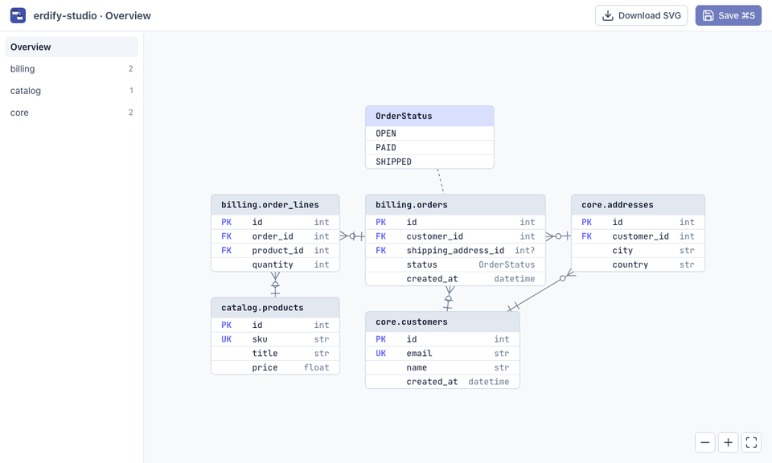
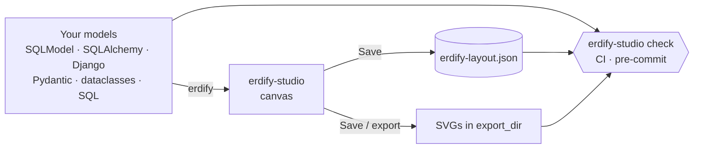

<p align="center">
  <picture>
    <source media="(prefers-color-scheme: dark)" srcset="https://raw.githubusercontent.com/devsuit-berlin/erdify-studio/main/docs/assets/erdify-studio-wordmark-dark.svg">
    
  </picture>
</p>

[](https://pypi.org/project/erdify-studio/)
[](https://pypi.org/project/erdify-studio/)
[](https://opensource.org/licenses/MIT)
[](https://github.com/devsuit-berlin/erdify-studio/actions/workflows/test.yml)
[](https://github.com/devsuit-berlin/erdify-studio/actions/workflows/test.yml)
[](https://erdify-studio.devsuit.io/)

> 🎨 Arrange your [erdify](https://github.com/devsuit-berlin/erdify) ERDs by drag and drop, commit the layout, and keep it in sync in CI!

**erdify** generates ERDs from your code (SQLModel, SQLAlchemy, Django, Pydantic,
dataclasses, SQL DDL), always auto-laid-out. **erdify-studio** adds a hand-made layout
that survives schema changes and is shared through git: `erdify-studio check` keeps it in
sync with your models, the same way `erdify --check` keeps a committed diagram in sync.
No Node, no database, no browser engine needed.

<p align="center">
  <picture>
    <source media="(prefers-color-scheme: dark)" srcset="https://raw.githubusercontent.com/devsuit-berlin/erdify-studio/main/docs/assets/studio-demo-dark.gif">
    
  </picture>
</p>

> **Status: alpha.** `check`, `place --auto`, the canvas (overview and group diagrams,
> live reload) and SVG export work. The layout file format is versioned; the Python API
> and the HTTP API between the canvas and the server may still change before 1.0.

## ✨ Features

- 🖱️ **Drag & Drop Canvas** - Arrange the diagrams in your browser; the edges follow, Ctrl/⌘+S saves
- 🗂️ **Group Diagrams** - An overview plus one diagram per schema, Django app or module, linked by foreign boxes
- 💾 **Layout in Git** - One JSON file next to your code, keyed by `schema.table`, so renaming a class keeps its position
- ✅ **Drift Check** - `erdify-studio check` fails CI/pre-commit when a table has no position or the layout holds stale entries
- 📍 **Auto-Place** - `place --auto` puts new tables next to related ones and never moves a placed box
- 🖼️ **SVG Export** - Byte-identical SVGs per diagram for your README and docs; `check` flags stale ones
- 🔄 **Live Reload** - Edit your models and the canvas follows within about a second; unsaved drags are never lost
- 🧬 **erdify's Own Model** - Every framework erdify reads, with erdify's entities and edges, never a re-implementation
- 🔒 **Local Only** - Served on `127.0.0.1` with a per-session token; no CDN, fonts and icons ship in the wheel

## 🤔 Why erdify-studio?

| | erdify alone | Drawn by hand (draw.io, Excalidraw, …) | **erdify-studio** |
|---|---|---|---|
| Diagram comes from your code | Yes | No | **Yes**, via erdify |
| Your own arrangement | No, auto layout | Yes | **Yes** |
| Follows schema changes | Yes | No, redraw by hand | **Yes**: new tables placed, removed ones dropped |
| Reviewable in git | PlantUML / Mermaid text | An editor file | **JSON positions + SVGs** |
| CI drift gate | `--check` | No | **`check`** |

studio stores **positions only**. Boxes, fields and edges always come from erdify, so the
diagram can't drift from your models, and a schema change never breaks your arrangement.

## 🚀 Quick Start

```bash
# Run without installing (or `pip install erdify-studio`; `erdify-studio[sql]` for SQL DDL)
uvx erdify-studio ./src            # open the canvas, drag, save
uvx erdify-studio check ./src      # in CI: exit 1 if the layout is out of date
uvx erdify-studio place --auto     # place new tables without the canvas
uvx erdify-studio export           # write one SVG per diagram to export_dir
```

Keep the layout in sync on every commit with [pre-commit](https://pre-commit.com):

```yaml
repos:
  - repo: https://github.com/devsuit-berlin/erdify-studio
    rev: v0.2.0
    hooks:
      - id: erdify-studio-check
        args: [./src]                               # optional, default: .
        # additional_dependencies: ['erdify[sql]']  # for SQL DDL
```

Options come from erdify's `[tool.erdify]` in `pyproject.toml`, plus:

```toml
[tool.erdify-studio]
layout = "docs/erd/erdify-layout.json"   # default: erdify-layout.json next to pyproject.toml
group_by = "auto"                        # auto | schema | app | module | none
export_dir = "docs/erd"                  # optional; omitted = no committed SVGs
```

## 🔄 How It Fits Together



## 📚 Documentation

- [Installation](https://erdify-studio.devsuit.io/installation/) — pip, the `[sql]` extra, Python and erdify versions
- [Quickstart](https://erdify-studio.devsuit.io/quickstart/) — your first layout in a few steps
- [The canvas](https://erdify-studio.devsuit.io/usage/canvas/) — group diagrams, foreign boxes, live reload, saving
- [Check in CI & pre-commit](https://erdify-studio.devsuit.io/usage/ci/) — what `check` reports, exit codes, the pre-commit hook
- [Place new tables](https://erdify-studio.devsuit.io/usage/place/) — how `place --auto` picks a spot
- [Export SVGs](https://erdify-studio.devsuit.io/usage/export/) — file names, determinism, Download SVG
- [Configuration](https://erdify-studio.devsuit.io/configuration/) — every `[tool.erdify-studio]` option and how entities are keyed
- [The layout file](https://erdify-studio.devsuit.io/layout-file/) — the versioned JSON format
- [Brand](https://erdify-studio.devsuit.io/brand/) — logo, colours and how to use them

## 💬 Community

Questions, ideas, or a layout you're proud of? Join the
[**Discussions**](https://github.com/devsuit-berlin/erdify-studio/discussions). Concrete
bugs and proposals go to [Issues](https://github.com/devsuit-berlin/erdify-studio/issues).

## 🤝 Contributing

Contributions are welcome! Please [open an issue](https://github.com/devsuit-berlin/erdify-studio/issues)
for bugs or feature requests, and see
[CONTRIBUTING.md](https://github.com/devsuit-berlin/erdify-studio/blob/main/CONTRIBUTING.md)
for guidelines. Shipped changes are tracked in the
[changelog](https://github.com/devsuit-berlin/erdify-studio/blob/main/CHANGELOG.md).

## 🔒 Security

For security concerns, please see [SECURITY.md](https://github.com/devsuit-berlin/erdify-studio/blob/main/SECURITY.md).

## 📄 License

This project is licensed under the MIT License - see the [LICENSE](https://github.com/devsuit-berlin/erdify-studio/blob/main/LICENSE) file for details.

## 🙏 Acknowledgments

erdify-studio stands on the shoulders of great open-source projects:

**Diagrams**

- [erdify](https://github.com/devsuit-berlin/erdify) - Reads your models and draws the entities and edges studio arranges

**Canvas**

- [Vue](https://vuejs.org/) - The canvas UI
- [Vite](https://vite.dev/) - Builds the frontend into the wheel
- [Nuxt UI](https://ui.nuxt.com/) and [Tailwind CSS](https://tailwindcss.com/) - Components and styling
- [Lucide](https://lucide.dev/) - Icons
- [JetBrains Mono](https://www.jetbrains.com/lp/mono/) - The diagram font

**Tooling & infrastructure**

- [uv](https://docs.astral.sh/uv/) - Packaging, builds and dependency management
- [Ruff](https://docs.astral.sh/ruff/) - Linting and formatting
- [mypy](https://mypy-lang.org/) - Static type checking
- [pytest](https://docs.pytest.org/) - Testing framework
- [Poe the Poet](https://poethepoet.natn.io/) - Task runner
- [pre-commit](https://pre-commit.com/) - Git hook management
- [MkDocs Material](https://squidfunk.github.io/mkdocs-material/) - The documentation site

**Community**

- [Contributor Covenant](https://www.contributor-covenant.org/) - Our Code of Conduct
- [Keep a Changelog](https://keepachangelog.com/) - Changelog format
- And everyone who [contributes](https://github.com/devsuit-berlin/erdify-studio/blob/main/CONTRIBUTING.md) issues, ideas and pull requests 💜

---

Created &amp; maintained with ❤️ by [devsuit GmbH](https://devsuit.de)
