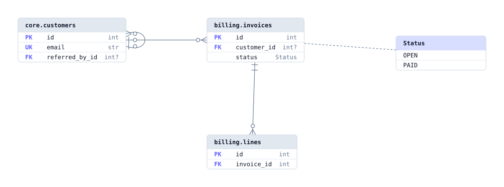

# erdify-studio

Arrange your [erdify](https://erdify.devsuit.io/) ERDs by drag and drop, commit the
layout to your repo and check in CI that it stays up to date.

erdify generates ERDs from your code (SQLModel, SQLAlchemy, Django, Pydantic,
dataclasses, SQL DDL), always auto-laid-out. erdify-studio adds a hand-made layout that
survives schema changes and is shared through git — the same way `erdify --check`
keeps a committed diagram in sync with the models.



- **Arrange** the overview and one diagram per schema, Django app or module in the
  browser; the canvas follows your model edits live.
- **Commit** the layout file (`erdify-layout.json`) and, if you like, the diagrams as
  SVG for your README and docs.
- **Check** in CI or pre-commit that the layout (and the SVGs) still match the models;
  `place --auto` fixes it without a browser.
- **Colour** the diagrams in your brand: set
  [`[tool.erdify-studio.colors]`](configuration.md#diagram-colours), or try colours live
  in the canvas's **Colours** panel and copy them as TOML.

```bash
pip install erdify-studio
erdify-studio            # open the canvas for the project in the current folder
```

Everything runs locally: the canvas is served on `127.0.0.1`, ships in the wheel and
loads nothing from the network.
