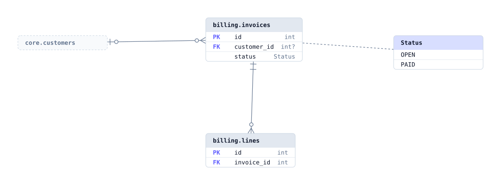

# The canvas

```bash
erdify-studio [path]                     # same as: erdify-studio open [path]
erdify-studio --no-browser --port 8765   # print the URL instead of opening a browser
```

Serves the diagrams on `127.0.0.1` (a free port unless `--port` is given) and opens
them in your browser; Ctrl+C stops it. Every entity shows its fields (PK / FK / UK
badges, type, `?` for nullable), enums erdify draws show their values, and the edges are
erdify's own, with crow's-foot ends.

- The list on the left switches between the overview and one diagram per group
  (`[tool.erdify-studio] group_by`). A group diagram shows its own entities, the enums
  they use, and a greyed-out, name-only **foreign box** for every entity of another
  group they are connected to. Click a foreign box to open its group's diagram; drag
  it to move it. A dot marks diagrams with unsaved changes; the URL keeps the open one.
- Each diagram has its own positions: moving an entity in one diagram doesn't move it
  in another.
- Drag a box: its edges follow and "Unsaved changes" appears. Drag the background to
  pan, scroll or use the buttons to zoom.
- **Save** (or Ctrl/⌘+S) writes every diagram to the layout file at once, so `check`
  passes afterwards; entries for tables or groups that no longer exist are dropped.
- Boxes without a position are placed like `place --auto` does and marked **NEW** until
  you save.
- **Live reload**: edit your models while studio is open and the canvas follows within
  about a second. New tables are placed next to your arrangement and marked NEW,
  removed ones disappear (and leave the layout file on the next Save), boxes whose
  columns change keep their position. Unsaved drags are never lost. While a model file
  can't be loaded (half-typed), studio keeps the last good diagram and says why.
- If the layout file changes on disk (a `git checkout`, another tab), studio says so;
  Save then refuses instead of overwriting it: reload the page.
- Closing the tab with unsaved changes asks first.

Like `check`, it exits 2 without starting when the canvas is not built (a source
checkout without `uv run poe frontend`), when the project, its config or the layout
file cannot be read, or erdify finds no entities. The page talks to the local server
only: no CDN, fonts and icons ship in the wheel, and the API needs the random token in
the URL it opens, so other web pages cannot change your layout.


